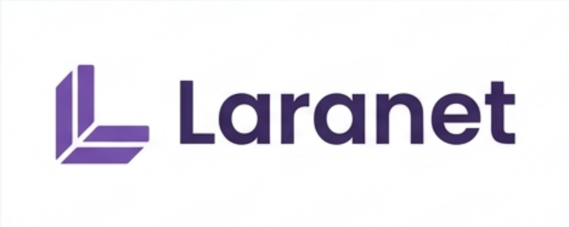

# Laranet



**A Laravel-inspired toolkit for .NET.**

Laranet brings expressive APIs, developer-friendly abstractions, and elegant patterns to the C# ecosystem.

Our goal is simple: make .NET development more productive, expressive, and enjoyable without compromising the principles and strengths of the platform.

> Don't make .NET look like Laravel. Make .NET feel better to work with.

## Philosophy

Laranet is built around a few core principles:

- **Expressiveness:** Write clean, readable, and intuitive code.
- **Productivity:** Reduce boilerplate and repetitive implementations.
- **Simplicity:** Prefer straightforward solutions over unnecessary complexity.
- **Extensibility:** Build abstractions that developers can customize and extend.
- **Native integration:** Embrace the .NET ecosystem rather than reinventing it.
- **Modularity:** Install only the packages an application needs.

Laranet is a **modular toolkit with framework-like tooling**. It does not replace
ASP.NET Core, EF Core, dependency injection, or the native .NET lifecycle. It adds
conventions, query utilities, integrations, and code generation on top of them.

## Packages

| Package | Purpose |
| --- | --- |
| `Laranet.Data` | Provider-neutral `IQueryable` search, sorting, filtering, and pagination. |
| `Laranet.EntityFrameworkCore` | Asynchronous EF Core pagination and optional conventions. |
| `Laranet.AspNetCore` | Pagination HTTP headers and Minimal API results. |
| `Laranet.Cli` | Project creation and code generation. |
| `Laranet.Http` | Typed, cancellation-aware convenience layer over `HttpClient` (next release). |
| `Laranet` | Core package, intentionally empty until a shared abstraction is justified. |

```bash
dotnet add package Laranet.Data
dotnet add package Laranet.EntityFrameworkCore
dotnet add package Laranet.AspNetCore
dotnet tool install --global Laranet.Cli
```

## Documentation

- [Documentation index](docs/README.md)
- [Installation](docs/getting-started/installation.md)
- [Quick start](docs/getting-started/quick-start.md)
- [Core concepts](docs/concepts/core-concepts.md)
- [API reference](docs/api/README.md)
- [Package overview](docs/packages/README.md)
- [Branding](docs/branding.md)

## Samples

- [Console sample](samples/Laranet.Samples.Console)
- [Web API sample](samples/Laranet.Samples.WebApi)

## Contributing

- [Contributing guidelines](CONTRIBUTING.md)
- [Development workflow](docs/development/development-workflow.md)
- [Testing guidelines](docs/development/testing-guidelines.md)
- [Security policy](SECURITY.md)

## Roadmap

- [Project roadmap](docs/roadmap/README.md)
- [Version 1](docs/roadmap/v1.md)
- [Version 2](docs/roadmap/v2.md)
- [Version 3](docs/roadmap/v3.md)
- [Version 4](docs/roadmap/v4.md)
- [Version 5 — `1.0.0`](docs/roadmap/v5.md)
- [Version 6](docs/roadmap/v6.md)

## License

Laranet is licensed under the [MIT License](LICENSE).
