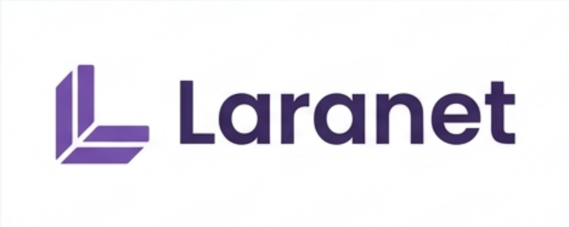

# Laranet Documentation

Welcome to the official documentation of **Laranet**.

Laranet is a Laravel-inspired toolkit for .NET, designed to improve the developer
experience through expressive APIs, reusable abstractions, and developer-friendly
patterns.

Our goal is not to make .NET look like Laravel, but to make .NET feel better to work
with.

## Getting Started

Learn how to install Laranet and start building applications with it.

- [Installation](getting-started/installation.md)
- [Quick Start](getting-started/quick-start.md)
- [First Application](getting-started/first-application.md)

## Concepts

Understand the philosophy and the ideas behind the toolkit.

- [Project Philosophy](concepts/philosophy.md)
- [Core Concepts](concepts/core-concepts.md)
- [Dependency Injection](concepts/dependency-injection.md)
- [Extensibility](concepts/extensibility.md)

## Architecture

Explore the internal architecture and the decisions that shape it.

- [Architecture Overview](architecture/overview.md)
- [Ecosystem Architecture](architecture/ecosystem.md)
- [Design Principles](architecture/design-principles.md)
- [Modularity](architecture/modularity.md)
- [Architecture Decision Records](architecture/decisions/README.md)

## Guides

Practical guides for the implemented features and the native patterns that work with
them.

- [Data Access](guides/data-access.md)
- [Pagination](guides/pagination.md)
- [EF Core Conventions](guides/ef-core-conventions.md)
- [Relationships](guides/relationships.md)
- [Validation](guides/validation.md)
- [Error Handling](guides/error-handling.md)
- [CLI](guides/cli.md)

## API Reference

Reference for the public API of every published package and the packages in
development.

- [API Reference](api/README.md)
- [Core (`Laranet`)](api/core.md)
- [Data (`Laranet.Data`)](api/data.md)
- [Integrations](api/integrations.md)
- [HTTP (`Laranet.Http`)](api/http.md)

## Packages

Understand what each package provides and when to use it.

- [Package Overview](packages/README.md)
- [`Laranet`](../src/Laranet/README.md)
- [`Laranet.Data`](../src/Laranet.Data/README.md)
- [`Laranet.EntityFrameworkCore`](../src/Laranet.EntityFrameworkCore/README.md)
- [`Laranet.AspNetCore`](../src/Laranet.AspNetCore/README.md)
- [`Laranet.Http`](../src/Laranet.Http/README.md)
- [`Laranet.Cli`](../src/Laranet.Cli/README.md)

## Samples

Runnable applications that combine the packages:

- [Console sample](../samples/Laranet.Samples.Console)
- [Web API sample](../samples/Laranet.Samples.WebApi)

## Compatibility

Learn about supported .NET versions, compatibility guarantees, and upgrade procedures.

- [Support Policy](compatibility/support-policy.md)
- [Versioning](compatibility/versioning.md)
- [Provider Compatibility](compatibility/providers.md)
- [Migration Guide](compatibility/migration-guide.md)

## Roadmap

Track current and future work.

- [Roadmap](roadmap/README.md)
- [Version 1](roadmap/v1.md)
- [Version 2](roadmap/v2.md)
- [Version 3](roadmap/v3.md)
- [Version 4](roadmap/v4.md)
- [Version 5 — `1.0.0`](roadmap/v5.md)
- [Version 6](roadmap/v6.md)

## Development

Resources for developers contributing to Laranet.

- [Contribution Guide](development/contribution-guide.md)
- [Development Standards](development/standards.md)
- [Development Workflow](development/development-workflow.md)
- [Testing](development/testing.md)
- [Testing Guidelines](development/testing-guidelines.md)
- [Release Process](development/release.md)
- [Contributing](../CONTRIBUTING.md)
- [Security Policy](../SECURITY.md)

## Branding

The visual identity and the assets used by the repository, the documentation, and the
NuGet packages.

- [Branding](branding.md)

## Project Status

Laranet is currently in early development.

Its APIs, architecture, and package structure may evolve as the project progresses.
The documentation covers the published packages and marks planned modules explicitly
in the [roadmap](roadmap/README.md); it does not describe them as available features.

## Contributing

Laranet welcomes bug reports, feature requests, documentation improvements, and code
contributions.

Before contributing, please read our [Contributing Guidelines](../CONTRIBUTING.md).

## License

Laranet is open source. See the repository's [LICENSE](../LICENSE) file for license
details.
