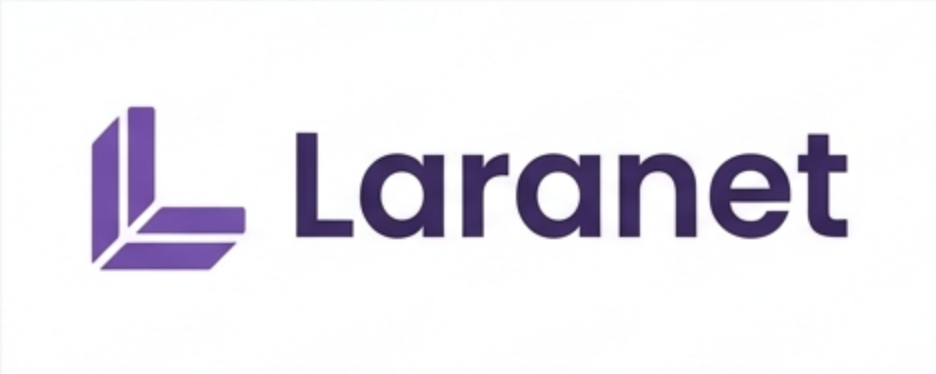
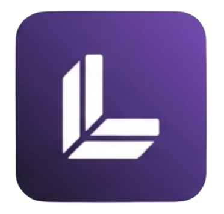

# Branding

This page documents the Laranet visual identity and the assets used across the
repository, the documentation, and the published NuGet packages.

All assets live in [`assets/branding`](../assets/branding).

## Logo

The horizontal logo is the default mark for README files, documentation, and
presentations.

## Icon

The icon is the square mark used for NuGet packages, application icons, and small
spaces where the wordmark would not be legible.

The image published inside every NuGet package is
`laranet_icon_out_wallpaper.png`. It is included by
[`Directory.Build.props`](../Directory.Build.props) so all production packages share
the same icon.

## Available assets

| Asset | Format | Intended use |
| --- | --- | --- |
| `laranet_horizontal_logo.png` | PNG, 936 × 374 | Primary logo on light backgrounds. |
| `laranet_icon_out_wallpaper.png` | PNG, 372 × 355 | NuGet package icon and square contexts. |
| `laranet_icon_out_wallpaper.svg` | SVG | Scalable version of the square icon. |
| `laranet_icon.png` | PNG, 372 × 355 | Alternative transparent icon. |
| `laranet_iso_type.png` | PNG, 649 × 376 | Isolated symbol without the wordmark. |
| `laranet_monocromatic.png` | PNG, 931 × 304 | Single-color composition. |
| `laranet_white.png` | PNG, 607 × 300 | Logo for dark backgrounds. |
| `laranet_dark.png` | PNG, 645 × 299 | Logo variant for dark themes. |

## Usage guidelines

- Keep the original aspect ratio. Do not stretch or squash an asset.
- Leave clear space around the logo. Do not place text directly against it.
- Use the light-background logo on white or light surfaces and the dark or white
  variants on dark surfaces.
- Do not recolor, rotate, or add effects to the mark.
- Prefer the SVG icon when a scalable asset is required.
- Do not embed the logo in a way that suggests endorsement by an unrelated project.

## Where the brand appears

| Location | Asset |
| --- | --- |
| [`README.md`](../README.md) | Horizontal logo |
| [`docs/README.md`](README.md) | Horizontal logo |
| NuGet packages | `laranet_icon_out_wallpaper.png` |
| This page | Logo, icon, and full asset inventory |

## Changing the brand

The icon and logo are part of the public identity of the project. Treat a change as
a documented design decision:

1. Add or replace the assets in `assets/branding`.
2. Update the package icon reference in `Directory.Build.props` if the icon file
   changes.
3. Update the `.nuspec` validation in
   [`.github/scripts/verify-packages.sh`](../.github/scripts/verify-packages.sh).
4. Update this page and any page that embeds the affected asset.
5. Rebuild and pack the packages to confirm that the icon is included.

## Related

- [Documentation index](README.md)
- [Roadmap: branding and identity](roadmap/README.md#branding-and-identity)
